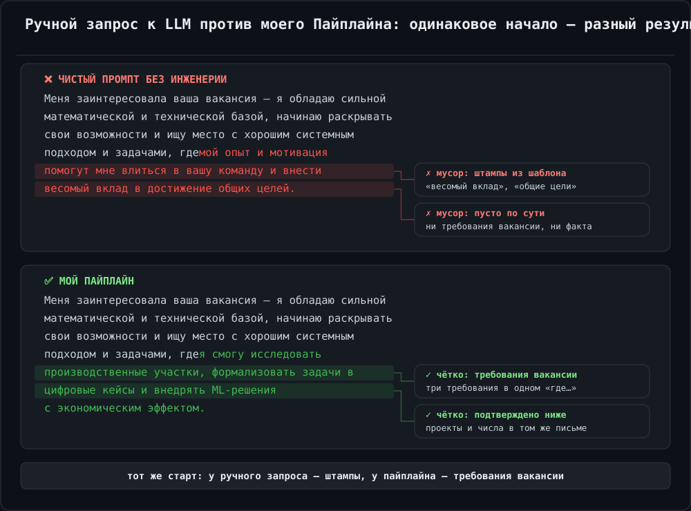
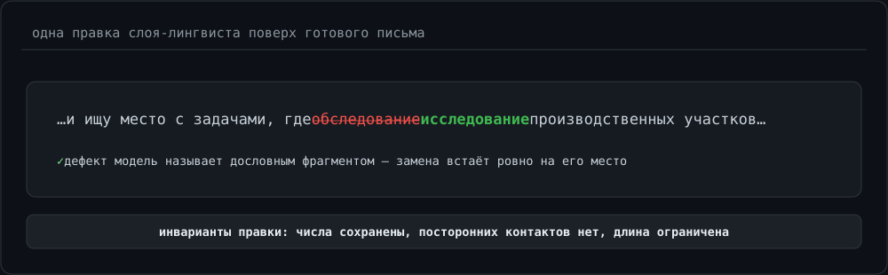
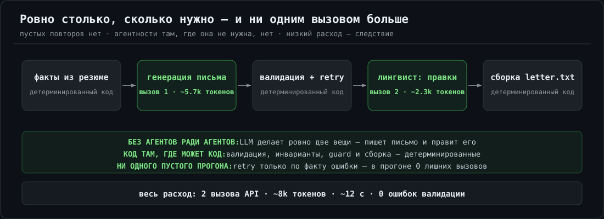
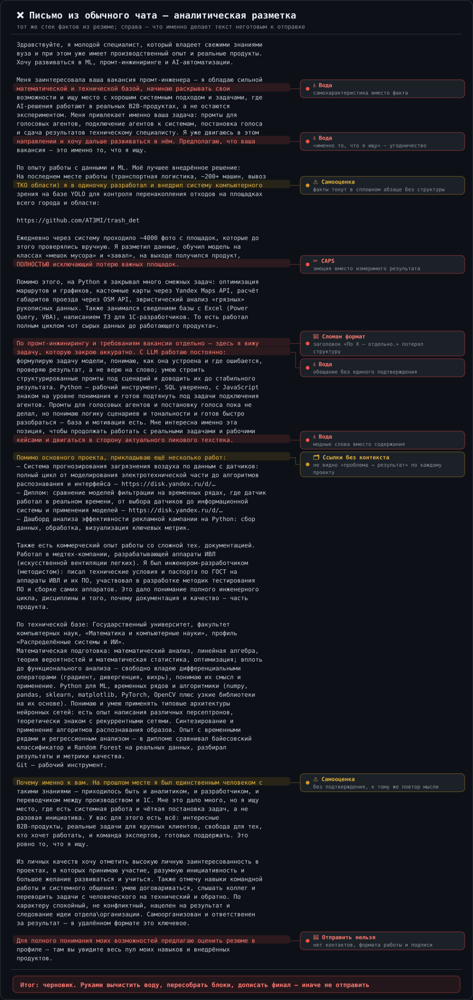
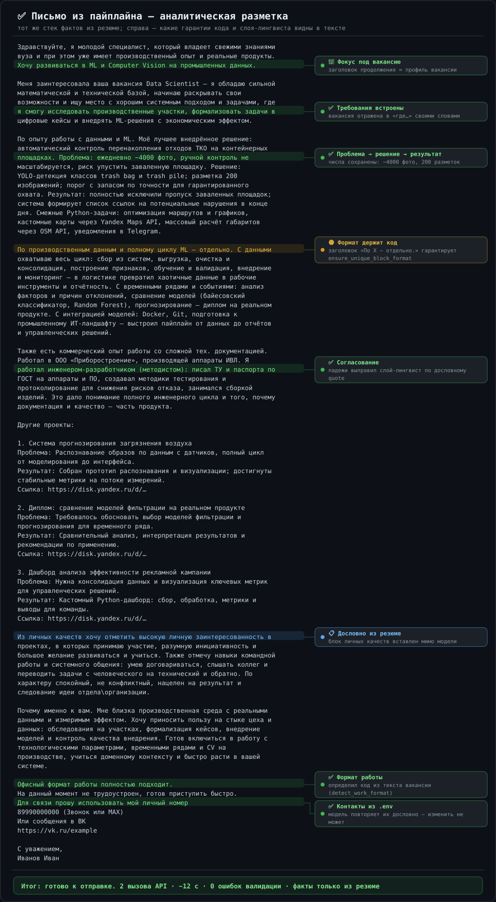
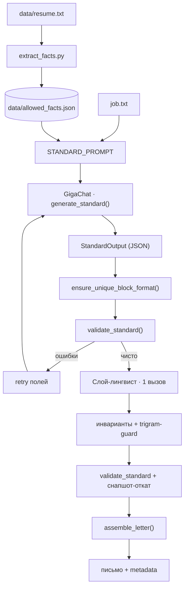

# job agent

[](https://github.com/AT3MI/job_agent/actions/workflows/tests.yml)
[](LICENSE)
[](requirements.txt)

## Пайплайн для сборки сопроводительного письма из резюме и требований вакансии.

Содержание письма пишет GigaChat по JSON-контракту, форму гарантирует Python, дефекты
перед выдачей правит слой-лингвист. 
Сравнение одного и того же начала письма —
ручной запрос к LLM против этого пайплайна:

<p align="center">
  
</p>

## Зачем это

Сопроводительное письмо под каждую вакансию пишется заново: расставить акценты,
поднять нужные проекты, уложиться в три-четыре абзаца. При 10–20 откликах в неделю
это рутина, и качество падает уже к двадцатому письму.

Чат с LLM это не решает: письмо выходит гладким и пустым — общие фразы вроде
«весомый вклад в достижение общих целей» с карточки выше, вода, лишние факты.
Вычищать такое руками — тот же труд под другим именем.

Этот пайплайн оставляет человеку только решение: загрузить вакансию и проверить
результат. Отбор фактов из резюме делает код, письмо пишет модель — но по строгому
JSON-контракту: структуру проверяет программа, негодный ответ уходит на переделку,
а приветствие, контакты и подпись собирает код. Финальную редактуру ведёт слой-лингвист:
второй вызов модели находит дефекты и предлагает правки, но код принимает их только
если те не ломают факты и форму.

## Слой лингвист в конце прогона

Поверх готового письма работает слой-лингвист: модель называет дефект дословным
фрагментом, код встраивает замену ровно на его место и проверяет правку инвариантами —
числа сохранены, посторонних контактов нет, длина ограничена.

<p align="center">
  
</p>

## Технологическая эффективность: ровно столько, сколько нужно

У каждого элемента пайплайна — своя работа: факты из резюме отбирает код, письмо пишет
модель по JSON-контракту, валидацию и повтор при ошибке делает код, текст правит
слой-лингвист, финальный файл собирает код. Два вызова с ясными ролями — написать письмо
и отредактировать его; агентность только там, где она нужна. Следствие такой архитектуры —
низкий расход: 2 вызова API, ~8k токенов и ~12 секунд на письмо.

<p align="center">
  
</p>

## Полные письма — нажмите на треугольник, чтобы раскрыть ▾

Оба письма собраны из одного и того же резюме под две разные вакансии (промпт-инженер
и Data Scientist) — акценты под требования меняются, факты нет. Контакты и ФИО заменены
на плейсхолдеры — в реальном пайплайне они берутся из `.env` и попадают в письмо дословно.
**Нажмите на строку с ▸** — раскроется письмо с аналитической разметкой; внутри ещё один
треугольник — тот же текст без разметки.

<details>
<summary>❌ Письмо из обычного чата — аналитическая разметка + полный текст</summary>

<p align="center">
  
</p>

<details>
<summary>Тот же текст без разметки</summary>

```text
Здравствуйте, я молодой специалист, который владеет свежими знаниями вуза и при этом
уже имеет производственный опыт и реальные продукты. Хочу развиваться в ML,
промт-инжиниринге и AI-автоматизации.

Меня заинтересовала ваша вакансия промт-инженера — я обладаю сильной математической
и технической базой, начинаю раскрывать свои возможности и ищу место с хорошим
системным подходом и задачами, где AI-решения работают в реальных B2B-продуктах,
а не остаются экспериментом. Меня привлекает именно ваша задача: промты для голосовых
агентов, подключение агентов к системам, постановка голоса и сдача результатов
техническому специалисту. Я уже двигаюсь в этом направлении и хочу дальше развиваться
в нём. Предполагаю, что ваша вакансия — это именно то, что я ищу.

По опыту работы с данными и ML. Моё лучшее внедрённое решение:
На последнем месте работы (транспортная логистика, ~200+ машин, вывоз ТКО области)
я в одиночку разработал и внедрил систему компьютерного зрения на базе YOLO для
контроля перенакопления отходов на площадках всего города и области:

https://github.com/AT3MI/trash_det

Ежедневно через систему проходило ~4000 фото с площадок, которые до этого проверялись
вручную. Я разметил данные, обучил модель на классах «мешок мусора» и «завал»,
на выходе получился продукт, ПОЛНОСТЬЮ исключающий потерю важных площадок.

Помимо этого, на Python я закрывал много смежных задач: оптимизация маршрутов
и графиков, кастомные карты через Yandex Maps API, расчёт габаритов проезда через
OSM API, эвристический анализ «грязных» рукописных данных. Также занимался сведением
базы с Excel (Power Query, VBA), написанием ТЗ для 1С-разработчиков. То есть работал
полным циклом «от сырых данных до работающего продукта».

По промт-инжинирингу и требованиям вакансии отдельно — здесь я вижу задачу, которую
закрою аккуратно. С LLM работаю постоянно: формулирую задачу модели, понимаю, как она
устроена и где ошибается, проверяю результат, а не верю на слово; умею строить
структурированные промты под сценарий и доводить их до стабильного результата.
Python — рабочий инструмент, SQL уверенно, с JavaScript знаком на уровне понимания
и готов подтянуть под задачи подключения агентов. Промты для голосовых агентов
и постановку голоса пока не делал, но понимаю логику сценариев и тональности
и готов быстро разобраться — база и мотивация есть. Мне интересна именно эта позиция,
чтобы продолжать работать с реальными задачами и рабочими кейсами и двигаться в сторону
актуального пикового техстека.

Помимо основного проекта, прикладываю ещё несколько работ:
— Система прогнозирования загрязнения воздуха по данным с датчиков: полный цикл
  от моделирования электротехнической части до алгоритмов распознавания и интерфейса —
  https://disk.yandex.ru/d/…
— Диплом: сравнение моделей фильтрации на временных рядах, где датчик работал
  в реальном времени, от выбора датчиков до информационной системы и применения
  моделей — https://disk.yandex.ru/d/…
— Дашборд анализа эффективности рекламной кампании на Python: сбор данных,
  обработка, визуализация ключевых метрик.

Также есть коммерческий опыт работы со сложной тех. документацией. Работал
в медтех-компании, разрабатывающей аппараты ИВЛ (искусственной вентиляции легких).
Я был инженером-разработчиком (методистом): писал технические условия и паспорта
по ГОСТ на аппараты ИВЛ и их ПО, участвовал в разработке методик тестирования ПО
и сборке самих аппаратов. Это дало понимание полного инженерного цикла, дисциплины
и того, почему документация и качество — часть продукта.

По технической базе: Государственный университет, факультет компьютерных наук,
«Математика и компьютерные науки», профиль «Распределённые системы и ИИ».
Математическая подготовка: математический анализ, линейная алгебра, теория
вероятностей и математическая статистика, оптимизация; вплоть до функционального
анализа — свободно владею дифференциальными операторами (градиент, дивергенция,
вихрь), понимаю их смысл и применение. Python для ML, временных рядов и алгоритмики
(numpy, pandas, sklearn, matplotlib, PyTorch, OpenCV плюс узкие библиотеки на их
основе). Понимаю и умею применять типовые архитектуры нейронных сетей: есть опыт
написания различных персептронов, теоретически знаком с рекуррентными сетями.
Синтезирование и применение алгоритмов распознавания образов. Опыт с временными
рядами и регрессионным анализом — в дипломе сравнивал байесовский классификатор
и Random Forest на реальных данных, разбирал результаты и метрики качества.
Git — рабочий инструмент.

Почему именно к вам. На прошлом месте я был единственным человеком с такими знаниями —
приходилось быть и аналитиком, и разработчиком, и переводчиком между производством
и 1С. Мне это дало много, но я ищу место, где есть системная работа и чёткая постановка
задач, а не разовая инициатива. У вас для этого есть всё: интересные B2B-продукты,
реальные задачи для крупных клиентов, свобода для тех, кто хочет работать, и команда
экспертов, готовых поддержать. Это ровно то, что я ищу.

Из личных качеств хочу отметить высокую личную заинтересованность в проектах,
в которых принимаю участие, разумную инициативность и большое желание развиваться
и учиться. Также отмечу навыки командной работы и системного общения: умею
договариваться, слышать коллег и переводить задачи с человеческого на технический
и обратно. По характеру спокойный, не конфликтный, нацелен на результат и следование
идеи отдела\организации. Самоорганизован и ответственен за результат — в удалённом
формате это ключевое.

Для полного понимания моих возможностей предлагаю оценить резюме в профиле — там вы
увидите весь пул моих навыков и внедрённых продуктов.
```

</details>
</details>

<details>
<summary>✅ Письмо из пайплайна — аналитическая разметка + полный текст</summary>

<p align="center">
  
</p>

<details>
<summary>Тот же текст без разметки</summary>

```text
Здравствуйте, я молодой специалист, который владеет свежими знаниями вуза и при этом
уже имеет производственный опыт и реальные продукты. Хочу развиваться в ML
и Computer Vision на промышленных данных.

Меня заинтересовала ваша вакансия Data Scientist — я обладаю сильной математической
и технической базой, начинаю раскрывать свои возможности и ищу место с хорошим
системным подходом и задачами, где я смогу обследовать производственные участки,
формализовать задачи в цифровые кейсы и внедрять ML-решения с экономическим эффектом.

По опыту работы с данными и ML. Моё лучшее внедрённое решение: автоматический
контроль перенакопления отходов ТКО на контейнерных площадках. Проблема: ежедневно
~4000 фото, ручной контроль не масштабируется, риск упустить заваленную площадку.
Решение: YOLO-детекция классов trash bag и trash pile; разметка 200 изображений;
порог с запасом по точности для гарантированного охвата. Результат: полностью
исключили пропуск заваленных площадок; система формирует список ссылок
на потенциальные нарушения в конце дня. Смежные Python-задачи: оптимизация
маршрутов и графиков, кастомные карты через Yandex Maps API, массовый расчёт
габаритов через OSM API, уведомления в Telegram.

По производственным данным и полному циклу ML — отдельно. С данными охватываю
весь цикл: сбор из систем, выгрузка, очистка и консолидация, построение признаков,
обучение и валидация, внедрение и мониторинг — в логистике превратил хаотичные
данные в рабочие инструменты и отчётность. С временными рядами и событиями:
анализ факторов и причин отклонений, сравнение моделей (байесовский классификатор,
Random Forest), прогнозирование — диплом на реальном продукте. С интеграцией
моделей: Docker, Git, подготовка к промышленному ИТ-ландшафту — выстроил пайплайн
от данных до отчётов и управленческих решений.

Также есть коммерческий опыт работы со сложной тех. документацией. Работал
в ООО «Приборостроение», производящей аппараты ИВЛ. Я работал инженером-разработчиком
(методистом): писал ТУ и паспорта по ГОСТ на аппараты и ПО, создавал методики
тестирования и протоколирование для снижения рисков отказа, занимался сборкой
изделий. Это дало понимание полного инженерного цикла и того, почему документация
и качество — часть продукта.

Другие проекты:

1. Система прогнозирования загрязнения воздуха
   Проблема: Распознавание образов по данным с датчиков, полный цикл от
   моделирования до интерфейса.
   Результат: Собран прототип распознавания и визуализации; достигнуты стабильные
   метрики на потоке измерений.
   Ссылка: https://disk.yandex.ru/d/…

2. Диплом: сравнение моделей фильтрации на реальном продукте
   Проблема: Требовалось обосновать выбор моделей фильтрации и прогнозирования
   для временного ряда.
   Результат: Сравнительный анализ, интерпретация результатов и рекомендации
   по применению.
   Ссылка: https://disk.yandex.ru/d/…

3. Дашборд анализа эффективности рекламной кампании
   Проблема: Нужна консолидация данных и визуализация ключевых метрик
   для управленческих решений.
   Результат: Кастомный Python-дашборд: сбор, обработка, метрики и выводы
   для команды.
   Ссылка: https://disk.yandex.ru/d/…

Из личных качеств хочу отметить высокую личную заинтересованность в проектах,
в которых принимаю участие, разумную инициативность и большое желание развиваться
и учиться. Также отмечу навыки командной работы и системного общения: умею
договариваться, слышать коллег и переводить задачи с человеческого на технический
и обратно. По характеру спокойный, не конфликтный, нацелен на результат и следование
идеи отдела\организации.

Почему именно к вам. Мне близка производственная среда с реальными данными
и измеримым эффектом. Хочу приносить пользу на стыке цеха и данных: обследования
на участках, формализация кейсов, внедрение моделей и контроль качества внедрения.
Готов включиться в работу с технологическими параметрами, временными рядами
и CV на производстве, учиться доменному контексту и быстро расти в вашей системе.

Офисный формат работы полностью подходит.
На данный момент не трудоустроен, готов приступить быстро.
Для связи прошу использовать мой личный номер
89990000000 (Звонок или MAX)
Или сообщения в ВК
https://vk.ru/example

С уважением,
Иванов Иван
```

</details>
</details>

## Как это работает



## Быстрый старт

Требуется Python 3.11+ и ключ GigaChat.

```bash
git clone https://github.com/AT3MI/job_agent.git
cd job_agent
python -m venv .venv
.venv\Scripts\activate          # Windows
pip install -r requirements.txt
copy .env.example .env          # Linux/macOS: cp .env.example .env
```

**Заполните `.env` — в нём три группы значений:**

| Переменная | Что положить |
|---|---|
| `GIGACHAT_CREDENTIALS` | **ваш ключ GigaChat** из личного кабинета. Файл `.env` игнорируется git — ключ нигде не хардкожен и не публикуется |
| `GIGACHAT_CA_BUNDLE_FILE` | путь к CA-сертификату Минцифры ([russian_trusted_root_ca.pem](https://gu-st.ru/content/lending/russian_trusted_root_ca.pem)), положите его в корень проекта |
| `COVER_PHONE`, `COVER_VK`, `COVER_NAME` | контакты для блока closing письма (телефон, ссылка ВК, подпись). В коде — только плейсхолдеры |

**Данные:**

```bash
copy data\resume.example.txt data\resume.txt   # заполните своим резюме
copy job.example.txt job.txt                    # вакансия, под которую генерируем
python extract_facts.py                         # извлечение фактов из резюме (несколько вызовов API)
python main.py job.txt                          # генерация письма → letter.txt + метаданные
```

`test_generation.py` — тот же прогон с расширенным отчётом; офлайн-тесты: `python test_linguist.py` (без API).

## Docker

```bash
docker build -t job_agent .
docker run --rm --env-file .env \
  -v ./job.txt:/app/job.txt:ro \
  -v ./data:/app/data:ro \
  -v ./russian_trusted_root_ca.pem:/app/russian_trusted_root_ca.pem:ro \
  job_agent
```

Резюме, вакансия, контакты и ключ передаются снаружи — внутри образа их нет.

## Что гарантирует код

- `closing` (формат работы, статус, контакты, подпись) не доверяется модели: шаблон подставляется из `.env`, модель только повторяет его дословно;
- `unique_block` всегда начинается с «По … — отдельно.» — формат чинится кодом (`ensure_unique_block_format`, идемпотентен) до и после LLM;
- письмо не содержит фактов, которых нет в резюме: модель ограничена `allowed_facts.json` + дословный блок личных качеств вырезается из резюме и вставляется мимо модели;
- числа не теряются, ссылки/контакты не появляются внутри правок, длина правок ограничена;
- trigram-guard: правка не может «запихнуть» дословный повтор 3+ слов из другого предложения того же поля;
- 4 уровня откатов: отказ правки инвариантом → verify (за флагом) → снапшот-откат по `validate_standard` → отключение слоя целиком (`SKIP_LINGUIST=1`). Любой сбой API — письмо без изменений.

## Метрики

| Параметр | Значение |
|---|---|
| Вызовов API на письмо | **2** (генерация + проверка лингвиста; раньше 3 — верификация вынесена в инварианты) |
| Токенов на письмо (замер 2026-11-14) | ~8.0k: генерация ~5.7k + лингвист ~2.3k |
| Ошибок валидации на прогоне | 0 |
| Офлайн-тесты | 63/63 (stub-клиент, без API) |
| Время генерации | ~12 с |

## Слой-лингвист: примеры правок

Грамматика и согласование (найдено и исправлено автоматически):

```text
- «Я был инженер-разработчик (методист):»
+ «Я был инженером-разработчиком (методистом):»

- «...задачами, где обследование производственных участков, формализация задач...»
+ «...задачами, где проводится обследование производственных участков, формализация задач...»
```

Повторы и тавтологии: заголовок «По … — отдельно.» заморожен кодом, конфликт повторов решается
в теле абзаца; правка, которая переносит повтор в новое место вместо устранения, отклоняется
инвариантом (`ngram_overlap`), письмо остаётся консервативно неизменным.

## Документация

- [docs/ENGINEERING_JOURNEY.md](docs/ENGINEERING_JOURNEY.md) — полная история решений с причинами:
  от «промпт — не контракт» до JSON-схемы, программной валидации, детерминизации и слоя-лингвиста;
- [docs/ARCHITECTURE.md](docs/ARCHITECTURE.md) — поток данных, контракт `StandardOutput`,
  инварианты применения, trigram-guard, уровни отката, конфигурация.

## Структура репо

```text
main.py                  — вход: python main.py [job.txt]
extract_facts.py         — резюме → data/allowed_facts.json (Structured Output)
config/
  schemas.py             — Pydantic-схемы: StandardOutput, схемы лингвиста
  identity.py            — контакты из .env (плейсхолдеры по умолчанию)
  paths.py               — пути от корня проекта
src/generation/
  standard.py            — STANDARD_PROMPT, generate_letter(), retry полей
  linguist.py            — слой-лингвист: check → apply (инварианты) [→ verify]
  client.py              — клиент GigaChat, бюджет токенов, статистика
  assemble.py            — детерминированная сборка текста письма
src/validation/
  deterministic.py       — структурная валидация
data/
  resume.example.txt     — фиктивный пример резюме (реальное — только локально)
data/allowed_facts.example.json
test_linguist.py         — 63 офлайн-проверки (stub-клиент)
docs/                    — архитектура, история решений, рабочий стейт
```

## Приватность

- ключ GigaChat и контакты живут **только в `.env`** (в git не попадает; в коде — плейсхолдеры);
- реальные `data/resume.txt`, `data/allowed_facts.json`, `job.txt` игнорируются git — в репозитории лежат фиктивные примеры;
- не публикуйте `.env`, ключ и сертификат нигде, кроме локальной машины.

## Лицензия

[MIT](LICENSE)
